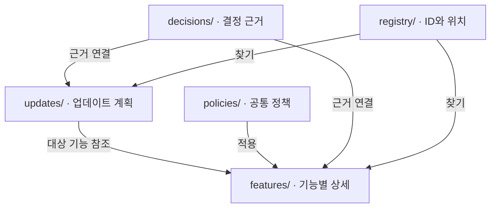

# Folioo 기획 문서

**업데이트별 전체 계획과 기능별 상세 명세를 나누어 관리하는 레포.**

원문 작성은 Notion·Figma·Markdown, 검토·승인본과 변경 이력 관리는 GitHub에서 진행.

[v.3 개요](updates/UPD-003/update-overview.md) · [v.3 PRD](updates/UPD-003/PRD.md) · [v.3 변경 범위](updates/UPD-003/changes.md)

## 관리 구조

업데이트마다 PRD·IA를 따로 보관하고, 같은 기능의 상세 문서는 업데이트가 바뀌어도 같은 기능 폴더에서 관리. 업데이트 문서에서 이번에 다루는 기능을 연결하는 구조.

| 관리 단위 | 경로 | 담는 내용 |
| --- | --- | --- |
| 업데이트별 계획 | `updates/<UPD-ID>/` | 해당 업데이트의 PRD·IA·기능별 변경 목록·최종본 참조 |
| 기능별 상세 | `features/<FEAT-ID>/` | 기능명세·화면 설명·Figma 와이어프레임 연결·기능 전용 정책 |
| 공통 정책 | `policies/` | 여러 기능에 공통으로 적용되는 정책 |
| 결정 근거 | `decisions/` | Notion 의사결정 기록과 관련 기능·화면·문서 연결 |
| 문서 색인 | `registry/` | 업데이트·기능·화면·문서 ID와 실제 파일 위치 |



## 폴더와 파일

```text
folioo-specs/
├── updates/                        # 업데이트별 계획
│   └── UPD-003/                     # 제품 업데이트 v.3
│       ├── update-overview.md        # 업데이트 개요와 관련 문서
│       ├── PRD.md                    # 업데이트 전체 기획
│       ├── changes.md                # 기능별 변경·계승 범위
│       └── manifest.json             # 원문·수집 정보
├── registry/                       # ID와 파일 위치 색인
│   ├── updates.json                 # 업데이트와 문서 위치
│   ├── documents.json               # 문서 ID와 위치
│   ├── features.json                # 기능 ID와 위치
│   └── screens.json                 # 화면 ID와 위치
├── README.md                       # 레포 소개와 문서 탐색
├── AGENTS.md                       # 조회·관리·검토·커밋·PR 공통 지침
├── CLAUDE.md                       # Claude Code 호환용 연결
├── .coderabbit.yaml                # CodeRabbit 설정
└── .gitignore                      # 로컬 파일 제외 규칙
```

문서 찾기: [업데이트 색인](registry/updates.json) · [기능 색인](registry/features.json) · [화면 색인](registry/screens.json) · [문서 색인](registry/documents.json)

## 다음 업데이트와 과거 문서

- 새 업데이트: `updates/<새 UPD-ID>/`에 독립 PRD·IA·변경 목록 보관. 이전 업데이트의 계획 문서도 같은 위치에 보존.
- 같은 기능의 유지·수정: `features/<같은 FEAT-ID>/`의 문서 계승·갱신. 업데이트의 변경 목록에서 신규·유지·일부 수정·전면 개편·폐기와 대상 문서 연결.
- 과거 최종본: 업데이트 완료 시 `release.json`에 확정한 참조와 고정 태그·승인 커밋으로 당시 기능·정책 조회.

문서·버전·계승·승인·PR 작성의 상세 기준은 [AGENTS.md](AGENTS.md) 참조.

<details>
<summary>문서 유형별 상세 파일 배치</summary>

문서 유형에 따른 경로와 파일 역할. `<UPD-ID>`·`<FEAT-ID>`·`<DEC-ID>`는 실제 ID를 나타내는 자리표시자.

### 업데이트 폴더: updates/&lt;UPD-ID&gt;/

| 파일 | 내용 |
| --- | --- |
| `update-overview.md` | 업데이트 개요와 관련 문서 진입점 |
| `PRD.md` | 업데이트 전체 기획 |
| `IA.md` | IA 텍스트 구조와 Figma 원문 연결 |
| `changes.md` | 기능별 변경·계승 범위와 관련 문서·PR |
| `manifest.json` | 업데이트 문서의 원문·수집 정보 |
| `release.json` | 완료 시 확정한 문서·버전·계승 출처·고정 참조 |

### 기능 폴더: features/&lt;FEAT-ID&gt;/

| 파일 | 내용 |
| --- | --- |
| `feature-overview.md` | 기능 개요와 관련 명세·화면·정책 진입점 |
| `spec.md` | 기능명세서와 적용 요구사항 |
| `screen-description.md` | 화면 설명·정책·예외와 화면요소 ID 참조 |
| `wireframe.json` | 선택한 Figma 파일·페이지·기능 Section·화면 Frame과 버전 |
| `elements.json` | 화면 설명에서 참조하는 요소 ID와 Figma 요소 연결 |
| `manifest.json` | 원문 URL·내용 해시·마지막 변경 업데이트·관련 파일 위치 |
| `policies/<policy-name>.md` | 기능 전용 정책 |
| `assets/` | 첨부자료 |

### 공통 문서

| 경로 | 내용 |
| --- | --- |
| `policies/<policy-name>.md` | 여러 기능이 함께 참조하는 공통 정책 |
| `decisions/<DEC-ID>.md` | 결정 내용·이유·근거 자료·적용 대상·대체 관계 |

</details>
